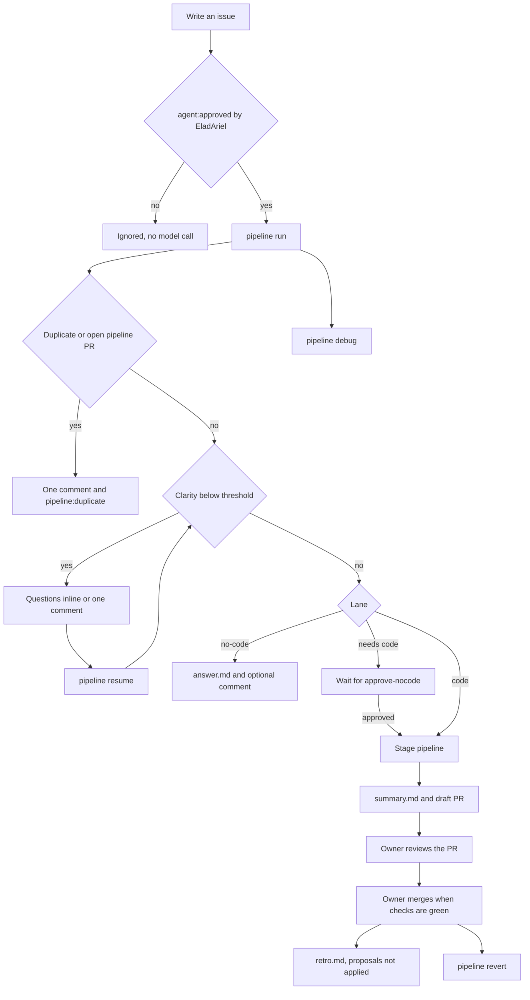
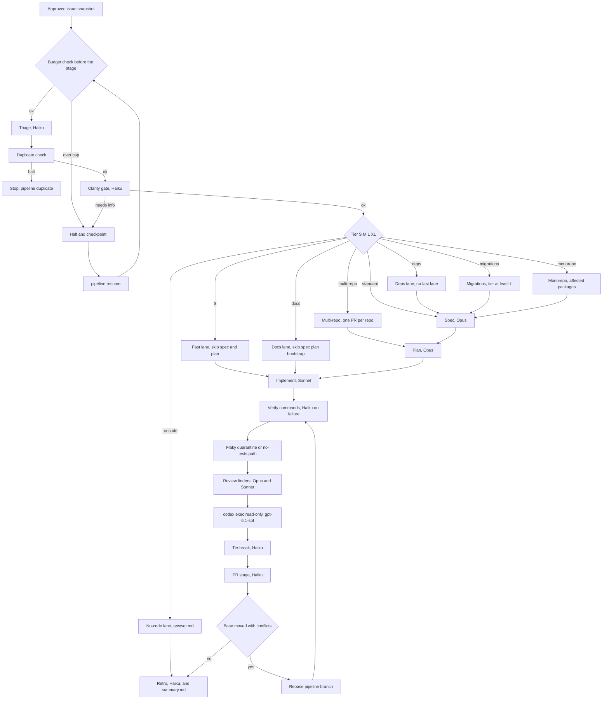
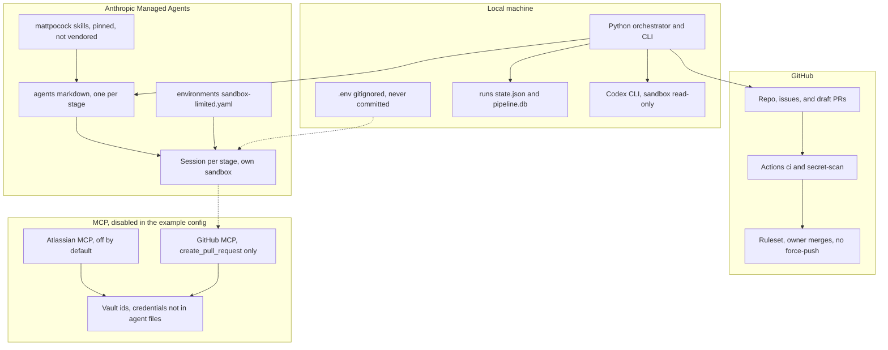

# claude-dev-pipeline

Status: **offline stages through retro**.

A local, deterministic Python orchestrator for a generic software-dev pipeline.
Each stage has an agent definition. The commands in this repository do not call
Anthropic or OpenAI, and they do not merge pull requests. Only the owner merges.

GitHub Issues are the source of truth for tasks. A dry-run prints the stage
plan and the issue payloads it would create.

## Diagrams

What the owner does. The pipeline does not merge.



Owner path from an approved issue through the local CLI to a merge the owner performs.

How a run moves. Models are the ids in `config/models.yaml`.



Stage order, lanes, and the configured model. A budget halt checkpoints the run for resume.

Where the pieces sit, and what they are allowed to see.



Trust boundary: API keys stay in gitignored `.env`. MCP credentials stay in vaults. The scaffold CLI does not call the API, and the example MCP servers are off.

## Stage order

Triage (Haiku) → spec (Opus, grill-with-docs / to-spec) → plan (Opus, to-tickets)
→ implement (Sonnet, one session per ticket, tdd) → verify → review (parallel
finders, including local `codex exec --sandbox read-only`, then a verifier vote)
→ draft PR (Haiku) → retro (Haiku). Retro records inline metrics on the same
run, inside that run's budget. There is no separate evaluation budget.

The default run cap is **$20**. Crossing it is a hard stop.

## Quickstart

```bash
python3 -m venv .venv
. .venv/bin/activate
pip install -e ".[dev]"
cp .env.example .env
```

Put `ANTHROPIC_API_KEY` in `.env` before a live Claude session, and
`OPENAI_API_KEY` before a real `codex` binary. Export them in the shell you
use for that session. The `pipeline` commands do not read `.env` and do not
call an API. Codex in this repo is `codex exec --sandbox read-only` when
`reviewers.codex.enabled` is true; if the binary is missing, review continues
with `cross_model` false. Herdr is optional (`docs/herdr.md`). From Claude
Code, `/pipeline` runs the same CLI and reports the run id and PR link
(`.claude/commands/pipeline.md`).

```bash
pipeline --dry-run --config config/pipeline.config.example.yaml
pipeline run "describe the change"
pipeline run --spec path/to/spec.md
pipeline run --issue 12 --issue-snapshot issues/12.json --model-fixture triage-response.json
pipeline run --issue 12 --no-push
pipeline status
pipeline report
pipeline import plan.json
```

`--no-push` writes `pr.json` and `pr-body.md` without pushing. Retro still
runs and writes `metrics.json` and `retro.md`. Proposals are not applied.
`pipeline report` prints the cost trend and, per stage, the share of model
calls that used the cheapest model on that stage's allowlist.

`--issue` runs only when the local snapshot shows that `EladAriel` applied
`agent:approved`. The scaffold does not call GitHub to check that. `pipeline
import` prints one issue per task and does not create issues unless you pass
`--apply`, which writes a local outbox and still does not call GitHub.

## Layout

- `src/claude_dev_pipeline/` — orchestrator package
- `config/` — models, budget caps, and the example target-repo config
- `docs/DESIGN.md` — approved design
- `docs/GITHUB_ISSUES.md` — issues, status labels, and the claude.ai Artifact note
- `docs/herdr.md` — optional herdr pane / `hc` usage
- `skills/manifest.yaml` — commit-pinned skill URLs, no copied skills
- `.claude/commands/pipeline.md` — Claude Code slash command

## Verify locally

```bash
ruff check .
ruff format --check .
pytest
pipeline scan-paths
gitleaks detect --source . --redact --config .gitleaks.toml
pipeline --dry-run --config config/pipeline.config.example.yaml
```

No hosted console check is part of this scaffold.
